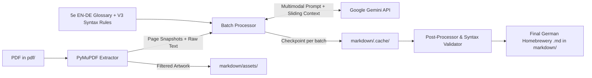

## Plan: Large D&D PDF to German Homebrewery V3 Converter

Build a Python-based CLI pipeline using **PyMuPDF (`fitz`)** and the **Google Gemini API (`google-genai`)** to extract, translate (English → Official German D&D 5e terminology), and format large D&D PDFs into **Homebrewery V3 Markdown** with semantic layout flow and local image asset extraction.

### Why This Architecture Works for Very Large PDFs
Converting a large D&D PDF in a single LLM request fails due to output token limits, lost 2-column reading order, and skipped statblocks. This pipeline handles large books reliably via four mechanisms:
1. **Multimodal + Text Hybrid Chunking**: Uses PyMuPDF to extract both raw text AND page snapshots (plus embedded artwork). Passing page snapshots alongside text to Gemini (`gemini-2.5-flash` or `gemini-2.5-pro`) allows the model to visually understand 2-column reading order, complex tables, sidebars, and monster statblocks.
2. **Sliding Context & Terminology Glossary**: Maintains a static EN→DE D&D 5e glossary (*Armor Class* → *Rüstungsklasse*, *Saving Throw* → *Rettungswurf*, *Challenge* → *Herausforderungsgrad*) plus a dynamic glossary of proper nouns/custom terms discovered during the run so translations stay consistent from page 1 to page 200+.
3. **Checkpoint & Resume System**: Processes pages in small batches (e.g., 2–4 pages per call) and saves each batch to `markdown/.cache/<pdf_name>/`. If a long run is interrupted or hits an API rate limit, it resumes from the exact batch without losing progress or re-spending tokens.
4. **Cross-Boundary Continuity & Post-Processing**: Passes the tail of the previous batch's Markdown into the next batch so statblocks or tables split across page boundaries merge into a single intact Homebrewery block.

---

### Steps

#### Phase 1: Project Scaffolding & Configuration
1. **Initialize Python environment & dependencies**:
   - Create `requirements.txt` with `pymupdf` (fast PDF text, layout, and image extraction), `google-genai` (official Gemini SDK), `python-dotenv` (API key & config management), `pydantic` (structured glossary/chunk outputs), `rich` (CLI progress bars), and `pillow` (image filtering).
   - Create `.env.example` for `GEMINI_API_KEY`, `GEMINI_MODEL` (default `gemini-2.5-flash`, configurable to `gemini-2.5-pro`), `BATCH_SIZE` (default `3`), and optional `IMGUR_CLIENT_ID`.
2. **Create German D&D 5e Reference Glossary (`src/glossary.json`)** (*parallel with step 1*):
   - Pre-populate official German D&D 5e terms: Ability scores (*STR, GES, KON, INT, WEI, CHA*), statblock fields (*Rüstungsklasse*, *Trefferpunkte*, *Bewegungsrate*, *Rettungswürfe*, *Schadensresistenzen*, *Zustandsimmunitäten*, *Sinne*, *Sprachen*, *Herausforderungsgrad*, *Übungsbonus*), action types (*Aktionen*, *Bonusaktionen*, *Reaktionen*, *Legendäre Aktionen*, *Nahkampf-Waffenangriff*), and spell headers (*Zauberzeit*, *Reichweite*, *Komponenten*, *Wirkungsdauer*).
3. **Create Homebrewery V3 Syntax Prompt Template (`src/prompts.py`)** (*parallel with step 1*):
   - Distill all formatting rules from `homebrewery-naturcrit-example` into a strict system instruction guide:
     - **Monster Statblocks**: `{{monster,frame` or `{{monster,frame,wide`, `___` dividers, `::` definition lists, `:` spacing between traits/actions.
     - **Spells & Spell Lists**: `#### Spell Name`, `*X. Grad, Schule*`, `**Zauberzeit:** :: ...`, and `{{spellList,wide ...}}`.
     - **Notes & Quotes**: `{{note ...}}` and `{{quote ... {{attribution ...}}}}`.
     - **Tables**: Extended table syntax including row-spanning (`^|`) and column-spanning (`||`).
     - **Images & Injection**: Curly attribute injection `{width:..., ...}` and image formatting.

#### Phase 2: PDF Extraction & Artwork Pipeline
4. **Build PDF Analyzer & Image Extractor (`src/extractor.py`)** (*depends on step 1*):
   - Open target PDFs from `pdf/` (such as `pdf/Trekiros - Syra's Guide to Killing Your PCs (for noobs).pdf`) using PyMuPDF.
   - **Smart Artwork Filtering**: Extract embedded images per page while filtering out full-page parchment background textures (by checking if an image repeats across pages or covers >90% of the page area) and tiny decorative strips/icons (<50x50px).
   - Save extracted artwork to `markdown/assets/<pdf_stem>/page_<N>_img_<M>.png`.
   - Render a 150 DPI snapshot of each PDF page for multimodal LLM input, alongside extracted raw text blocks.

#### Phase 3: LLM Translation & Homebrewery Conversion Engine
5. **Implement Chunked Gemini Translator (`src/converter.py`)** (*depends on steps 2, 3, 4*):
   - Slice the PDF into batches of $N$ pages (default 3 pages).
   - For each batch, pass:
     - The rendered page snapshots + raw text for those pages.
     - Available extracted artwork file paths for those pages.
     - The tail of the previous batch's generated Markdown (sliding window context to smoothly finish any split statblock, table, or paragraph).
     - The static 5e German glossary + dynamically accumulated document glossary.
   - Use Gemini's structured output or tagged sections to return:
     1. The translated and formatted **Homebrewery V3 Markdown** with semantic `\column` and `\page` breaks and embedded ` {width:...}` links.
     2. Newly discovered proper nouns/terms to merge into the running glossary (`markdown/.cache/<pdf_stem>/glossary_dynamic.json`).
   - Save each completed batch to `markdown/.cache/<pdf_stem>/batch_<NNN>.md` with automatic exponential backoff for rate limits.

#### Phase 4: Stitching, Validation & Optional Image Uploader
6. **Build Post-Processor & Syntax Validator (`src/postprocess.py`)** (*depends on step 5*):
   - Stitch all cached batch files into `markdown/<pdf_stem>.md`.
   - Validate Homebrewery V3 syntax:
     - Ensure all opening `{{` blocks have matching closing `}}` brackets.
     - Verify `___` horizontal rules and `| STR | GES | KON | INT | WEI | CHA |` tables inside `{{monster,frame}}` blocks.
     - Strip stray markdown code fences if the LLM wrapped any batch output.
7. **Create Optional Image Uploader (`src/upload_assets.py`)** (*parallel with step 6*):
   - Standalone utility script that scans `markdown/<pdf_stem>.md` for local `assets/...` links, uploads the images to Imgur (when `IMGUR_CLIENT_ID` is provided), and updates the Markdown file with live HTTPS URLs so images render directly inside the online Homebrewery editor.
8. **Create CLI Entrypoint (`convert.py`)** (*depends on steps 5, 6, 7*):
   - Provide CLI options:
     - Input file or `--all` to process all PDFs in `pdf/`.
     - `--pages 1-6` to test a specific page range on large PDFs before running the full book.
     - `--resume` / `--force` to control checkpoint caching.
     - `--model` to switch between `gemini-2.5-flash` and `gemini-2.5-pro`.

---

### Relevant Files
- `homebrewery-naturcrit-example` — Reference source for Homebrewery V3 syntax (`{{monster,frame}}`, `{{note}}`, `{{quote}}`, `{{spellList,wide}}`, `^|` / `||` spanned tables, and `::` definition lists).
- `pdf/Trekiros - Syra's Guide to Killing Your PCs (for noobs).pdf` — Sample D&D PDF in workspace for testing extraction, translation, and statblock formatting.
- `convert.py` *(to create)* — Main CLI runner for converting single or multiple PDFs.
- `src/extractor.py` *(to create)* — PyMuPDF text/snapshot renderer and background-filtered artwork extractor.
- `src/converter.py` *(to create)* — Gemini API multimodal batch translator with checkpointing and sliding-window context.
- `src/prompts.py` & `src/glossary.json` *(to create)* — Homebrewery V3 prompt instructions and official German D&D 5e glossary.
- `src/postprocess.py` *(to create)* — Batch stitcher and `{{...}}` curly-bracket syntax validator.
- `src/upload_assets.py` *(to create)* — Optional Imgur uploader to replace local asset paths with web URLs.

---

### Verification
1. **Pilot Slice Run**: Run `python convert.py "pdf/Trekiros - Syra's Guide to Killing Your PCs (for noobs).pdf" --pages 1-5` to verify that text, tables, and monster statblocks are accurately translated to German and formatted in V3 syntax, and that artwork is saved to `markdown/assets/`.
2. **Syntax & Bracket Audit**: Run the validator on the generated Markdown file to ensure zero unbalanced `{{` / `}}` blocks and properly formatted statblock headers.
3. **Homebrewery Live Preview**: Copy the generated Markdown into https://homebrewery.naturalcrit.com/new to visually verify rendering of monster frames, notes, tables, and column breaks.
4. **Checkpoint Resume Test**: Run pages 1–10 after the 1–5 pilot run and verify that pages 1–5 are loaded from cache while only pages 6–10 invoke the Gemini API.
